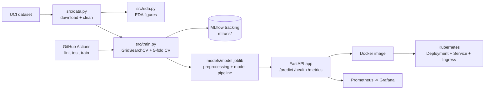

# MLOps Heart Disease Prediction (AIMLCZG523 - Assignment 01)

End-to-end MLOps project: predict heart disease risk from the UCI Heart Disease (Cleveland) dataset, with experiment tracking (MLflow), CI (GitHub Actions), a containerized FastAPI service, Kubernetes manifests and Prometheus monitoring.

Author: Durgesh Verma

Repository: https://github.com/avdurgesh/MlOps-heart-diseae-durgesh-verma-AIMLCZG523

## Architecture



## Project structure

```
src/            data, EDA, features, training and inference code
app/            FastAPI model-serving API
tests/          pytest unit tests (data, model, API)
data/           raw (gitignored) and processed datasets
models/         saved model pipeline + metrics.json
reports/        EDA figures
k8s/            Kubernetes manifests (Deployment, Service, Ingress)
monitoring/     Prometheus config
screenshots/    screenshots for the report
docs/           final report
.github/workflows/ci.yml   CI pipeline
```

## Setup

Linux / macOS / VM:

```bash
python3 -m venv .venv
source .venv/bin/activate
pip install -r requirements.txt
```

Windows (PowerShell):

```powershell
python -m venv .venv
.\.venv\Scripts\Activate.ps1
pip install -r requirements.txt
```

## Run the pipeline

```bash
python -m src.data      # download UCI data, clean it -> data/processed/heart_clean.csv
python -m src.eda       # EDA figures -> reports/figures
python -m src.train     # tune + evaluate models, log to MLflow, save models/model.joblib
python -m src.predict   # sample prediction from the saved model
mlflow ui --backend-store-uri ./mlruns   # view experiments at http://localhost:5000
pytest                  # unit tests
flake8 src tests app    # lint
```

The cleaned dataset is committed, so training works even without internet access. `python -m src.data` re-downloads it from the UCI repository.

## Data and modelling

- Dataset: UCI Heart Disease (Cleveland), 303 rows, 13 features. The target (0-4) is collapsed to binary (0 = no disease, 1 = disease).
- Cleaning: drop duplicates, fill the few missing `ca`/`thal` values with the mode.
- Features: numeric (`age`, `trestbps`, `chol`, `thalach`, `oldpeak`) are standardised; categorical (`sex`, `cp`, `fbs`, `restecg`, `exang`, `slope`, `ca`, `thal`) are one-hot encoded. Both steps live inside the sklearn `Pipeline`, so serving applies the exact same preprocessing as training.
- Models: Logistic Regression and Random Forest, tuned with `GridSearchCV` (5-fold stratified CV, ROC-AUC) on an 80/20 stratified split.

| Model | CV accuracy | CV precision | CV recall | CV ROC-AUC | Test ROC-AUC |
|-------|-------------|--------------|-----------|------------|--------------|
| Logistic Regression | 0.847 | 0.877 | 0.783 | 0.902 | 0.966 |
| Random Forest | 0.806 | 0.811 | 0.764 | 0.901 | 0.947 |

The best model by CV ROC-AUC (Logistic Regression) is saved to `models/model.joblib`. Every run logs parameters, CV and test metrics, ROC curve, confusion matrix and the model to MLflow.

## API

```bash
uvicorn app.main:app --port 8000
```

```bash
curl -X POST http://localhost:8000/predict -H "Content-Type: application/json" -d '{
  "age": 63, "sex": 1, "cp": 1, "trestbps": 145, "chol": 233, "fbs": 1,
  "restecg": 2, "thalach": 150, "exang": 0, "oldpeak": 2.3, "slope": 3, "ca": 0, "thal": 6
}'
# {"prediction":0,"confidence":0.834,"probability_disease":0.166}
```

Other endpoints: `GET /health`, `GET /metrics` (Prometheus), `GET /docs` (Swagger). Every request is logged with method, path, status and latency.

## Docker

```bash
docker build -t heart-disease-api:1.0 .
docker run -d --name heart-api -p 8000:8000 heart-disease-api:1.0
curl http://localhost:8000/health
```

## Monitoring (Prometheus + Grafana)

```bash
docker compose up --build
```

- API: http://localhost:8000, Prometheus: http://localhost:9090, Grafana: http://localhost:3000 (default login admin/admin).
- In Grafana add a Prometheus data source with URL `http://prometheus:9090`, then chart `api_requests_total`, `api_request_latency_seconds` and `model_predictions_total`.

## Kubernetes (Minikube on the VM)

```bash
minikube start
eval $(minikube docker-env)              # build the image inside Minikube
docker build -t heart-disease-api:1.0 .
kubectl apply -f k8s/deployment.yaml
minikube addons enable ingress           # optional, for ingress.yaml
kubectl apply -f k8s/ingress.yaml
kubectl -n heart-disease get pods,svc
minikube service -n heart-disease heart-disease-api --url
```

Use `minikube tunnel` if the LoadBalancer service stays in `<pending>`. Check `kubectl config current-context` before applying so the manifests go to the intended cluster.

## CI

`.github/workflows/ci.yml` runs on every push and pull request: lint (flake8), unit tests (pytest with coverage), data preparation and model training. It fails on any lint, test or training error, and uploads the model, MLflow runs, training log, test results and coverage as workflow artifacts.
